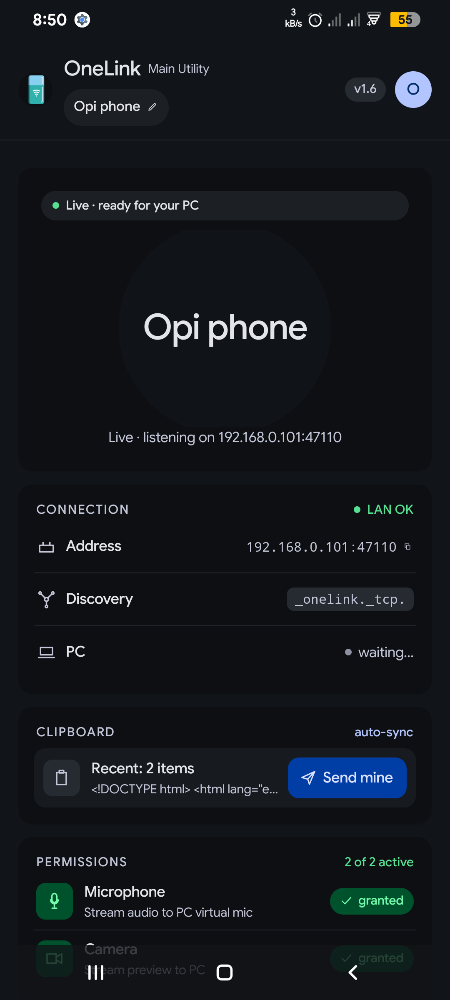
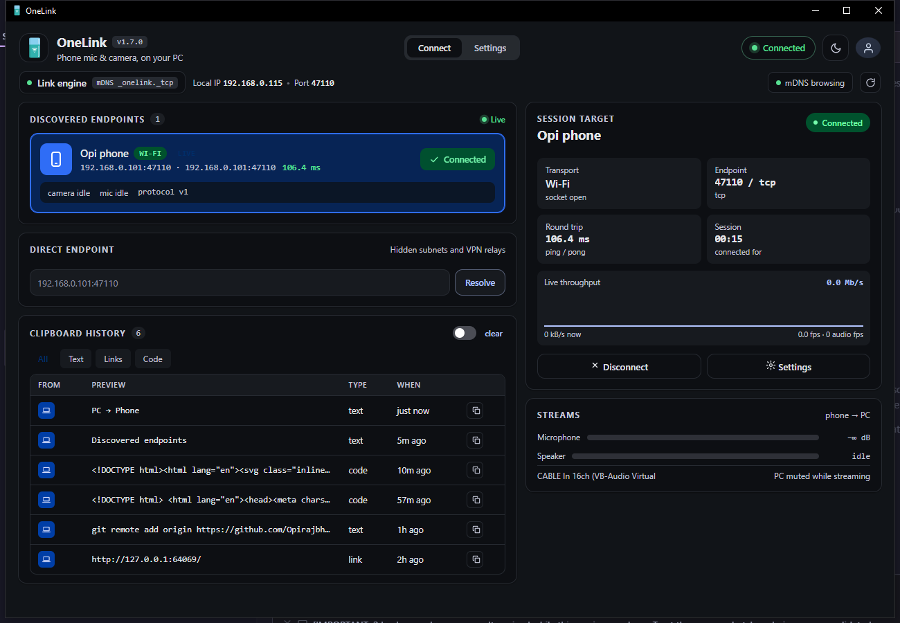
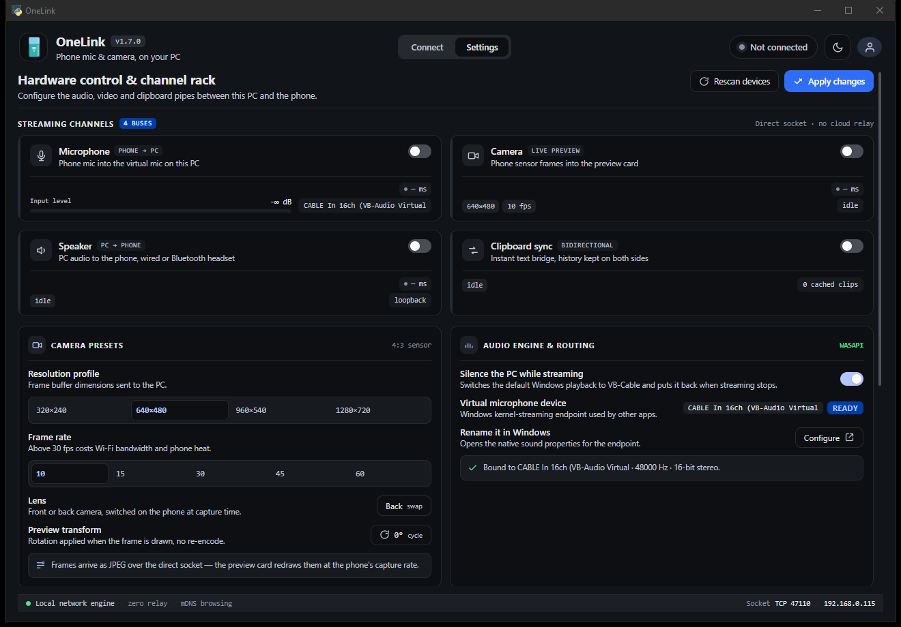

# OneLink

**Use your phone's microphone and camera on your PC — over Wi-Fi or a USB cable.**

OneLink turns an Android phone into a wireless mic and camera for a Windows PC. The phone does the
capturing; the PC just receives. No cloud account, nothing to root, nothing leaves your local
network.

| Phone app | PC — Connect | PC — Settings |
|---|---|---|
|  |  |  |

---

## What it gives you

- **Phone microphone on your PC** — Discord, Zoom, Teams, OBS and anything else see it as a normal
  microphone, because OneLink feeds it through a virtual audio cable.
- **Phone camera on your PC** — a live preview window, front or back lens, with rotation.
- **PC audio on your phone** — send the PC's sound to the phone, so it can reach earbuds paired to
  the phone.
- **Clipboard sync** — copy text on one side, paste it on the other, with history on both.
- **Quiet in the background** — closing the window sends OneLink to the system tray; it keeps
  working until you quit from there.
- **One copy only** — clicking the icon again brings the open window forward instead of starting a
  second app.

---

## What you need

- Windows 10 or 11 (64-bit).
- An Android phone (Android 8 or newer) on the **same Wi-Fi network** as the PC — or a USB cable
  with USB debugging turned on.
- **VB-Cable** (free) if you want the phone mic to be selectable as a microphone in other apps:
  <https://vb-audio.com/Cable/>. Install it once and reboot. Everything else works without it; you
  just won't have a virtual microphone to pick.

---

## How to use it

**1. Install the PC app.** Run `OneLink-Setup-<version>.exe`. It installs for the current user — no
admin prompt — and adds a desktop shortcut. OneLink starts in the system tray.

**2. Install the phone app.** Open `OneLink-<version>.apk` on the phone and allow installs from that
source when Android asks.

**3. Open the phone app and allow the microphone and camera prompts.** That's the entire setup: the
app starts listening right away and shows its address, e.g. `192.168.0.101:47110`.

**4. On the PC, open OneLink.** Your phone shows up under **Discovered endpoints** within a second
or two — press **Connect** on its card. If it doesn't appear:
   - check both devices are on the same Wi-Fi network (guest networks and VPNs hide devices);
   - or type the address shown on the phone into **Direct endpoint** and press **Resolve**.

**5. Pick what you want** on the **Settings** page — Microphone, Camera, Speaker, Clipboard. Every
channel has its own switch and nothing is on until you flip it. The camera card also holds
resolution, frame rate and lens.

**6. Use it.** In Discord/Zoom/Teams/OBS choose `CABLE Output` as the microphone. The camera preview
appears in the OneLink window.

**7. Put it away.** Close the window — OneLink stays in the tray. Quit from the tray icon when
you're done.

### Over USB instead of Wi-Fi

Plug the phone in and turn on **USB debugging** (Settings → About phone → tap *Build number* seven
times, then Developer options → USB debugging). The phone then appears in OneLink as a **USB**
device. It's the lowest-latency option and doesn't depend on Wi-Fi.

---

## If something doesn't work

- **Phone not listed** — allow OneLink through the Windows firewall the first time it asks; that
  prompt is what lets it find devices on your network.
- **Silent mic in the other app** — install VB-Cable, then select `CABLE Output` as the input.
- **No video** — the phone needs to be unlocked once after opening the app; Android blocks camera
  capture from the background otherwise.
- **Choppy video** — drop to 640×480 and 15 fps on the Settings page.

---

## Built with

- **Phone app** — Kotlin on the plain Android framework (no AndroidX, no third-party libraries), a
  foreground service for capture, and a Quick Settings tile.
- **PC app** — Python 3 with a pywebview window, a small local HTTP bridge, packaged with
  PyInstaller.
- **Networking** — one plain TCP socket between the two devices (port `47110`); devices are found
  with mDNS (`_onelink._tcp`) or adb; there is no relay server.
- **Audio** — WASAPI loopback on the PC and the VB-Audio Virtual Cable for the virtual microphone.
- **Packaging** — Inno Setup for the per-user Windows installer, Gradle for the APK.

The wire format both halves speak is documented in [PROTOCOL.md](PROTOCOL.md).

---

## Downloads

The latest Windows installer and Android APK live on the
[releases page](https://github.com/Opirajbhor/OneLink-Phone-Sensors-to-PC/releases/latest).

---

<details>
<summary>For developers — building from source</summary>

Needs JDK 17, Android SDK with `platforms;android-35` / `build-tools;35.0.0`, and Python 3.11+.

```bash
# phone app
cd android && ./gradlew assembleDebug
# → android/app/build/outputs/apk/debug/app-debug.apk

# PC app
python -m PyInstaller --noconfirm --onedir --windowed --name OneLink \
  --paths pc --add-data "pc/onelink/webui;onelink/webui" \
  --icon pc/onelink/webui/icon.ico --distpath release/app \
  --hidden-import pystray --hidden-import zeroconf --hidden-import soundcard \
  --hidden-import numpy entry.py

# installer
"C:\Program Files (x86)\Inno Setup 6\ISCC.exe" installer.iss
```

Running from source: `pc/run.bat` (tray), `--window` (window), `--serve` (headless, prints a local
URL), `--selftest` (15 checks including a VB-Cable loopback, no phone needed).

`release/` and `toolchain/` are gitignored — rebuild them, don't commit them.

</details>
